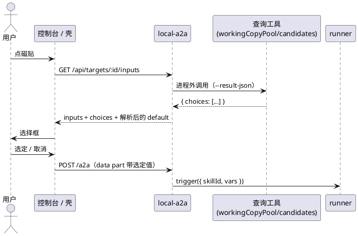

# ADR-0020: 磁贴运行时输入：点击时选参数，候选项由能力包提供

- 状态：Accepted
- 日期：2026-11-16（同日审阅通过）
- 讨论来源：2026-11-16 工作副本池（workingCopyPool 能力包）用户故事讨论。用户指出固定操作大多是“事情固定、对象要挑”，例如“开分支并启动 Unity”，现有磁贴只能跑写死的参数，做不到“点了先选再跑”

## Context

现有磁贴是“一键跑固定参数”。能挑对象的只有两处，都不满足需要：

- 能力包参数的 `enum`（[ADR-0019](0019-capability-pack-protocol.md) §1）只在编辑 target 时生成下拉框，选定后写进 `with`，点击时不再询问。
- 点击后唯一的停顿是 `input-required`，只服务 `requiresApproval`，选项固定为批准或拒绝（[ADR-0005](0005-single-task-state-enum.md)）。

但“触发时带值”这条链路已经全程存在，缺的只是声明与界面：

- 控制台：`src/local-a2a.mjs` 的 `POST /a2a` 把 `message.parts` 里 `kind: "data"` 的内容合并成 `vars`，交给 `trigger({ skillId, vars })`。
- Hub 委派：`src/tunnel-client.mjs` 的 `parseTriggerText` 解析 `run <id> {json}`，`vars: { ...runCfg.vars, ...vars }` 交给 `runner.launch`。
- 插值：`src/runner.mjs` 的 `run(triggerVars)` 按“触发时 vars > target vars > 模板默认值”合并，`interp` 无来源即抛错（契约 §1.2）。
- 能力派生：`src/card.mjs` 的 `deriveCard` 已把 `vars` 的键名写进技能描述（“参数：…”）。

候选项必须是动态的。以工程池为例，可选分支取决于池里现有槽位、常驻列表、最近使用和 SVN 上的活跃分支，写死在 target 里第二天就过期。

## Decision

target 可以声明 `inputs`，列出点击时要询问的变量；候选项可以是静态列表，也可以由能力包的查询工具在点击时现场给出。选定的值作为普通触发 vars 进入现有链路，执行期不新增任何状态，也不改动任务状态机。

### 1. target 字段

```yaml
targets:
  open-branch:
    title: 开分支
    expose: a2a
    audit: summary
    requiresApproval: false
    notify: on-failure
    inputs:
      - name: branch
        label: 分支
        choices: { uses: workingCopyPool/candidates }
        default: last
        allowCustom: true
    steps:
      - uses: workingCopyPool/acquire
        with: { branch: "{{branch}}" }
      - uses: osg/unity-open
        cwd: "{{workspace}}"
```

| 字段 | 类型 | 说明 |
| --- | --- | --- |
| `name` | string | 变量名，`^[A-Za-z_][A-Za-z0-9_]*$`，与插值 `{{name}}` 对应 |
| `label` | string | 选择框上显示的名字，缺省用 `name` |
| `choices` | string[] 或 `{ uses, with?, cwd? }` | 静态列表，或查询工具引用，省略表示自由输入 |
| `default` | string | 静态默认值，或 `last`（本 target 上次选的值） |
| `allowCustom` | boolean | 是否允许输入列表外的值，缺省 false；无 `choices` 时恒为 true |
| `required` | boolean | 缺省 true；false 时允许空串 |

装载期校验（`validateTargetsData` 之后，与 uses 预检同处）：

- `inputs` 的 `name` 不得与本 target 的 `vars` 重名，避免两个来源争优先级。
- `choices.uses` 引用的工具必须存在且声明为查询工具（见 §3）。
- 带 `schedule` 的 target，每个必填 input 都必须有静态 `default`。`last` 不算，因为它在首次运行前没有值。

### 2. 点击流程



- 没有 `inputs` 的磁贴行为不变，点击即触发。
- 用户在选择框取消时不建任务。选择发生在任务之前，所以不会留下 canceled 记录。
- `/api/tiles` 每项新增 `inputs: true|false`，前端据此决定点击后是先弹框还是直接触发。
- `last` 的值记在 `<state>/input-memory.json`（`<state>` 即运行时状态目录 `stateDir`），键为 `<targetId>.<name>`。只在任务受理成功后写入，失败或取消不覆盖。

### 3. 查询工具（ADR-0019 增量，只增不改）

toolset.json 的工具可以声明 `"kind": "query"`，缺省为 `"action"`，即现有行为。

- 调用方式与 §2 相同，额外约定：`--result-json` 文件可以带 `choices`：

```json
{
  "choices": [
    { "value": "exp", "label": "体验服", "hint": "就绪 · 落后 3" },
    { "value": "release_1.12", "hint": "需新建，预计 10 分钟" }
  ]
}
```

- 查询工具必须只读。内核不加路径锁，不受 `concurrency` 约束，固定超时 15 秒，不走 lowPriority。
- 超时、失败或返回格式非法时，选择框仍会弹出：列表为空，显示错误原因，并临时允许自由输入。这样查询工具坏了不会让磁贴完全用不了。
- 查询工具不能作为 `uses` step 使用，装载期拦截。反过来，action 工具也不能作为 `choices.uses`。

### 4. 触发时的取值与校验

`local-a2a.trigger` 和 `tunnel-client` 收到触发后，在 `runner.launch` 之前统一调用 `resolveInputs(target, vars)`：

1. 已传入的值直接使用。
2. 未传入时，按 `default` 取值。`last` 无记录视为缺值。
3. 必填项仍缺值时，按 [ADR-0009](0009-launch-failure-must-be-terminal.md) 当场失败，消息列出缺少的 input 及其 label。
4. 静态 `choices` 且 `allowCustom: false` 时，值必须在列表内。动态 choices 在触发时不再重新查询校验，合法性交给执行工具自己判断（例如 `workingCopyPool/acquire` 对不存在的分支报错）。

这样定时、Hub、对等三种无人值守的触发都走同一套规则：要么显式传值，要么用默认值，否则明确失败。

### 5. Hub 与能力卡

- 本 ADR 只要求 agent 本机控制台弹出选择框。
- `deriveCard` 把 `inputs` 写进技能描述，列出名称、label 和静态候选项，供 Hub 与对等方显式传参。
- Hub 侧的选择框需要 Hub 能实时向 agent 请求候选项，要新增一种 tunnel 帧，留给后续 ADR。在那之前，Hub 触发带 inputs 的 target 时，只能显式传值或用默认值。

## Consequences

- 收益：一个 target 覆盖“同一件事、不同对象”，不必为每个分支各建一个磁贴；候选项的业务知识留在能力包里，内核保持无领域代码（PRD-7 目标）；执行链路、任务状态、审批语义都不变。
- 收益：查询工具是通用机制，工程池之外，Unity 场景列表、bug 单列表这类候选项也能用同一种方式接入。
- 代价：`target.json` 新增 `inputs`，属于契约改动，需按 [ADR-0004](0004-contract-copy-boundary.md) 先改 Hub 仓 SSOT，再同步本仓锁定拷贝，契约版本升到 2.6，并与 Hub 同批推送。
- 代价：点击到开始执行之间多一次进程启动和查询，通常不到 1 秒；查询工具慢时，用户要等最多 15 秒。
- 代价：动态候选项在触发时不再复核，界面上看到的列表和实际执行之间可能有短暂不一致，由执行工具兜底。
- 被否决的方案一：执行中用 `input-required` 挂起询问。这会把“补充输入”混进审批语义，违背 [ADR-0005](0005-single-task-state-enum.md) 对该状态的定义；用户取消选择会留下大量 canceled 任务；Hub 看到的是挂起中的任务而不是一个选择框。而且候选项本来就需要在任务开始前算好，放进任务里并不省事。
- 被否决的方案二：只允许静态 `enum`。分支、场景这类对象每天都在变，静态列表要靠人手维护，正是要解决的问题。
- 被否决的方案三：一律交给对话型 agent 处理。对话适合需要判断的事，对“事情固定、只挑对象”的操作来说太慢，结果也不稳定，用户明确要求这类操作走固定入口。
- 被否决的方案四：每个对象建一个 target。数量会随分支膨胀，并且仍然需要有人维护列表。

## 核对

- 触发 vars 入口：`src/local-a2a.mjs` 的 `POST /a2a` 分支与 `trigger()`；`src/tunnel-client.mjs` 的 `parseTriggerText` 与 `runner.launch` 调用处。
- 插值与优先级：`src/runner.mjs` 的 `run()`、`interp()`。
- 磁贴数据：`src/local-a2a.mjs` 的 `GET /api/tiles`。
- 能力描述：`src/card.mjs` 的 `deriveCard`。
- 装载期预检：实际落在 `src/card.mjs` 的 `validateInputDefs`（inputs 定义）与 `validateUsesSteps`（step 引用查询工具即报错），与 uses 预检同处；未放进 `src/packs/diagnose.mjs`。
- 取值、last、查询：`src/inputs.mjs`（`resolveInputs`、`createInputMemory`、`createInputService`）；`last` 文件实际位于 `<state>/input-memory.json`。
- 界面：`desktop/src/components/inputs-dialog.tsx`（选择框，接在 `pages/actions-page.tsx`；首页磁贴无执行按钮，不涉及）、`components/inputs-editor.tsx`（Target 表单编辑 inputs）。
- 测试：`test/inputs.test.mjs`、`test/target-form.test.mjs`。
- 若决策落地，需要同步改的文档：Hub 仓 `schemas/target.json` 与契约说明；本仓 `src/contract/schemas/target.json`、[PRD-2](../prd/prd-2-targets-and-editor.md)（字段表、变量插值一节）、[ADR-0019](0019-capability-pack-protocol.md)（§1 增加 `kind`，§3 增加 `choices`）、`architecture/local-api.md`（新接口）。2026-11-16 已全部同步。

## 审阅结论（2026-11-16）

1. 字段名定为 `inputs`。不用 `prompt`，避免与模型提示词混淆。
2. 查询工具超时 15 秒，失败时退化为可自由输入，按 §3 执行。
3. Hub 侧选择框推迟到后续 ADR，第一版只在本机控制台提供选择框，按 §5 执行。
