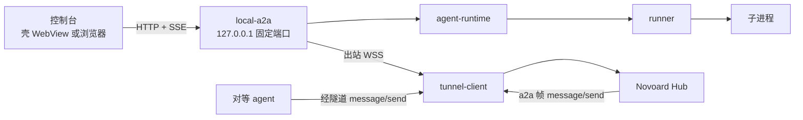

# 本仓架构文档

描述 agent 侧的真实形态。契约语义以 Hub 仓为唯一权威源，本文档只做引用与消费说明（[ADR-0004](../adr/0004-contract-copy-boundary.md)）。

| 文件 | 内容 |
| --- | --- |
| [overview.md](overview.md) | 进程模型：壳 + sidecar、固定端口、监听边界、宿主协议、数据目录 |
| [execution-state.md](execution-state.md) | 七态机、产出点、进度字段、三链路时序、四处终态集合 |
| [local-api.md](local-api.md) | 本机 HTTP 面：磁贴、SSE、A2A JSON-RPC、编辑器、会话、对等 |
| [session-and-peer.md](session-and-peer.md) | 会话生命周期、对等通信、委派、三种触发的关系 |

## 拓扑

两条关键约束：

连接方向永远是 sidecar 向外。Hub 与对等方都无法主动连本机，这决定了进度必须由本机推上去。

委派任务不写本地任务表。它只存在 `agent-runtime` 的 `running` Map 里，所以磁贴与控制台看不到它。
