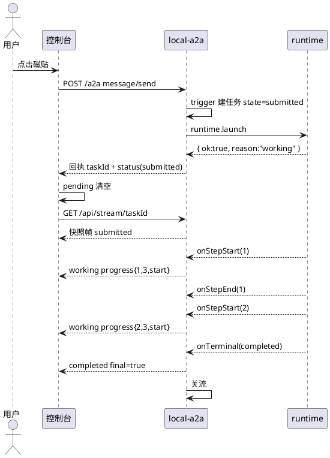
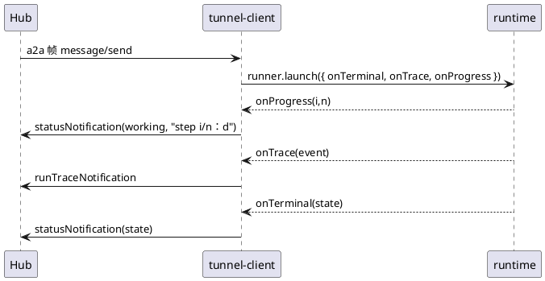
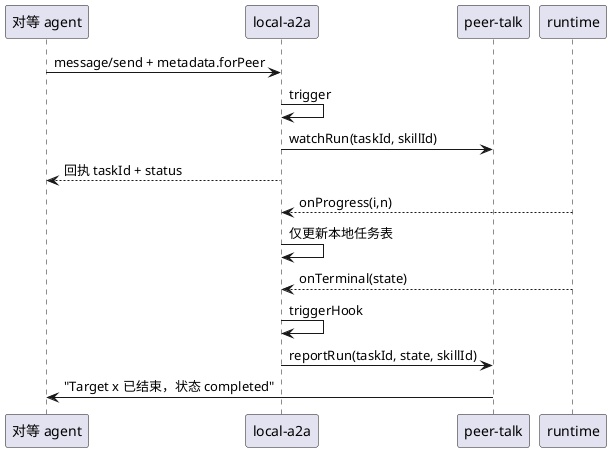

# 执行状态

本文描述任务状态从产生到终结的完整路径。[ADR-0006](../adr/0006-accept-then-push.md) 定方向，[ADR-0005](../adr/0005-single-task-state-enum.md) 定唯一状态模型，[ADR-0007](../adr/0007-progress-channel.md) 定通道，[ADR-0008](../adr/0008-step-level-progress.md) 定进度粒度。

## 状态枚举

七个状态，来源是 `src/contract/schemas/task.json` 的 `status.state.enum`：

```
submitted | working | input-required | completed | failed | canceled | rejected
```

终态集合在代码里出现四次，其中一处不一致：

| 位置 | 集合 | 备注 |
| --- | --- | --- |
| `src/local-a2a.mjs:19` | `completed, failed, canceled, rejected` | 本地任务表 |
| `src/main.mjs` 的 `TERMINAL_STATES_SET` | `completed, failed, canceled, rejected` | 终态钩子 |
| `src/tunnel-client.mjs` 的 `TERMINAL_OK` | `completed, failed, canceled` | 缺 `rejected`，上行会丢 |
| `desktop/src/pages/actions-page.tsx` | 只认 `working / completed / canceled` | 其余落到"失败" |

`TERMINAL_OK` 缺 `rejected` 意味着：一个被拒绝的任务在本地被判为终态，但 `uplinkTerminal` 会直接 `return`，Hub 永远收不到。这是 [ADR-0005](../adr/0005-single-task-state-enum.md) 要求收敛的直接原因。

## 各状态的产出点

| 状态 | 谁写 | 触发条件 |
| --- | --- | --- |
| `submitted` | `local-a2a.trigger` | 建任务时，`status.message` 为空串 |
| `working` | `agent-runtime.startExecution` / `local-a2a` 的 `onProgress` | 开始执行；`local-a2a` 里由进度回调覆盖 |
| `input-required` | `agent-runtime.launch` | `targetDef.requiresApproval === true`，挂起等审批 |
| `completed` | `agent-runtime.finish` | runner 返回 `ok: true` |
| `failed` | `agent-runtime.finish` / `local-a2a.trigger` | 步骤失败、超时、`launch` 被拒 |
| `canceled` | `local-a2a` 的 `tasks/cancel` / runner | 用户取消、本机停机 |
| `rejected` | 无人产出 | 见下 |

`rejected` 在当前代码里没有任何产出点：契约定义了这个状态，终态集合包含它，但本仓没有任何路径会置出这个值。它实际由 Hub 侧在管理面（成员离线的 `offline: reject`、审批驳回等）产出。
`local-a2a.mjs` 的 `trigger` 在 target 不存在时直接返回 `{ ok: false, reason }` 给 A2A 层，A2A 层返回 `-32002` 错误，不会建任务。所以本地视角下 `rejected` 目前是"只可能从外部进来"的状态。

## 状态机

```plantuml
@startuml
hide empty description
[*] --> submitted : trigger 建任务
submitted --> working : startExecution 成功
submitted --> failed : launch 被拒（并发满/停机）
submitted --> input-required : requiresApproval
input-required --> working : resume
input-required --> canceled : 审批超时 / 用户取消
working --> completed : 全部步骤成功
working --> failed : 步骤失败 / 超时
working --> canceled : 用户取消 / 停机
completed --> [*]
failed --> [*]
canceled --> [*]
rejected --> [*] : 仅外部置入
@enduml
```

两条容易写错的迁移：

- `submitted` 直接到 `failed` 合法。`startExecution` 在并发已满时返回 `{ ok: false, reason }`，任务从未进入 `working`。
- `input-required` 不是终态。`launch` 会立刻回调一次 `onTerminal("input-required", ...)`，但 `running` 里保留 `pending`，`resume` 后继续执行。名字叫 `onTerminal` 但这里不是终点，这是历史命名遗留。

## 进度字段

`runner.mjs` 的回调签名：

```js
createRunner({ ..., onProgress, onStepStart, onStepEnd })
```

- `onStepStart({ index, command })`：步骤开始，`index` 从 1 起。
- `onStepEnd({ index, exit })`：步骤结束。
- `onProgress(i, n, describeStep(...))`：在 `await runStep(...)` **之后**触发，语义是"第 i 步已完成"。

`agent-runtime` 把 `onProgress` 包成 `(i, n) => onProgress?.(i, n, \`第 ${i}/${n} 步\`)`，`local-a2a` 用它把任务置为 `working` 并把 `status.message` 设成这句中文。

所以当前的进度语义是"已完成步数"，界面若显示成"正在执行第 i 步"会提前一格。改法见 [ADR-0008](../adr/0008-step-level-progress.md)：改用 `onStepStart` / `onStepEnd`。

目标视图形状（本机视图，不是契约）：

```json
{
  "id": "task-local-m1x2y3-a4b5c6",
  "target": "plan",
  "title": "做个计划",
  "state": "working",
  "status": { "state": "working", "message": "第 2/3 步" },
  "progress": {
    "step": 2,
    "total": 3,
    "phase": "start",
    "label": "npm run build",
    "startedAt": "2026-10-20T08:12:03.114Z",
    "elapsedMs": 47210
  },
  "submittedAt": "2026-10-20T08:12:03.002Z",
  "updatedAt": "2026-10-20T08:12:50.324Z",
  "log": "plan/task-local-m1x2y3-a4b5c6.jsonl"
}
```

约定：

- `progress` 在 `submitted` 阶段为 `null`；`working` 阶段必有 `step` 与 `total`。
- `elapsedMs` 由服务端算。页面在两次帧之间本地递推，收到新帧后校准。
- `label` 是给人看的一句描述，不保证格式稳定，客户端禁止解析。
- 终态时 `progress` 保留最后值，`elapsedMs` 变为总用时。
- `phase` 是本机新增字段，不上行（上行仍只用 `status.message`，见 ADR-0004 的契约边界）。

## 三条链路的时序

### 本地点击



关键点：

- 回执先于订阅。`trigger` 里 `tasks.put(task)` 在 `runtime.launch` 之前，所以订阅一定能查到。
- `/api/stream/:id` 对已存在的任务先写一帧快照；对已是终态的任务写完即关。
- 同一 target 第二次点击时 `startExecution` 返回失败，`trigger` 置 `failed` 但当前**没有 `emit(id)`**，也没有调 `triggerHook`。这是 [ADR-0009](../adr/0009-launch-failure-must-be-terminal.md) 要修的第一处。

### Hub 委派



这条链路的三路回调都接了：`onProgress`、`onTrace`、`onTerminal`。是三条里最完整的。

两个缺口：

- `runner.launch({...})` 的返回值被丢弃。`launch` 在停机、未知 target、并发满时返回 `{ ok: false, reason }`，此时任务从未启动，`onTerminal` 不会被调用，Hub 视角永远停在"已受理"。
- `message/resume` 分支只在失败时上行，成功时不上行 `working`，Hub 要等第一个 `onProgress` 才知道恢复了。

### 对等触发



缺口最大的一条。`watchRun` 只把 taskId 记进 `watched` Map，中途零帧。`reportRun` 只在终态由 `main.mjs` 的 `triggerHook` 调一次。

而且 `watchRun` 依赖 `caller` 单例：

```js
function watchRun(taskId, skillId) {
  if (!caller || !taskId) return;
  watched.set(taskId, skillId);
}
```

`caller` 为空时（例如没有活跃对等消息）登记直接失败，终态时 `watched.get` 返回 undefined，`reportRun` 返回 `{ ok: false, reason: "not-watched" }`，结果静默丢失。见 [ADR-0010](../adr/0010-peer-context-per-session.md)。

## 视图与订阅的关系

| 出口 | 形状 | 用途 |
| --- | --- | --- |
| `GET /api/tiles` 的 `last` | 扁平 `{ state, message, at, log }` | 磁贴初始状态，每 4 秒轮询 |
| `GET /api/stream/:taskId` 帧 | `{ kind, taskId, status, final }` | 运行期实时 |
| `GET /api/tasks/:taskId` | 完整视图（待新增） | 重进、重连、兜底查询 |
| `tasks/get` | A2A 形状 `{ id, status, kind, history }` | A2A 标准查询 |

`last` 与流帧形状不同，界面要写两套渲染。这是 [ADR-0007](../adr/0007-progress-channel.md) 要求同构的原因。

## 数据来源

任务表在 `local-a2a.mjs` 的 `createLocalTasks()`，纯内存 Map，进程重启即清。历史输出在 `logs/shortcuts/<target>/<taskId>.jsonl`，保留 30 天。为什么不落盘见 [ADR-0011](../adr/0011-task-table-in-memory.md)。
