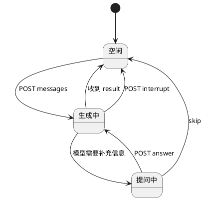
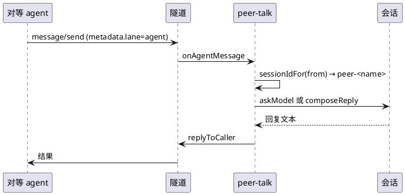

# 会话与对等

## 本地会话

会话是用户在本机与模型的对话单元。存储由 `session-store.mjs` 负责（`index.json` + `sessions/<id>.jsonl`），能力由 `chat-bridge.mjs` 调 `chat-worker.mjs`，模型来自 CodeBuddy 配置。

生命周期：



关键点：

- `POST /api/sessions/:id/messages` 返回 SSE 流，不是一次性响应。模型输出逐块推送，最后一行是 `{ kind: "result", session }`。
- 中断由 `chat.interrupt` 处理，与任务取消是两套机制：前者终止模型调用，后者终止子进程。
- 提问（会话级）在本机是会话事件，不是任务状态。与任务的 `input-required` 词同义不同，见下。

## 会话提问 vs 任务审批

| | 会话提问 | 任务审批 |
| --- | --- | --- |
| 谁在等 | 模型等用户补充信息 | 子进程等审批才能启动 |
| 状态表示 | 会话事件（`questionId`） | 任务状态 `input-required` |
| 恢复入口 | `POST /api/sessions/:id/answer` | `tasks/approve` / `message/resume` |
| 实现模块 | `chat-worker` / `ask-user.mjs` | `agent-runtime` 的 `pending` |

两者独立实现。文档与代码里都要避免混用，否则排查时会走错方向。提示词里也明确要求："还缺关键信息时调用 `novoard_request_detail`，等对方下一条消息，不要用脚本审批的恢复。"

## 对等通信

对等是"另一个 agent 直接给本机发消息"，不经 Hub 的业务语义，只借隧道传输。

### 消息进来说明



`sessionIdFor` 把发送方名字清洗成 `peer-<name>`（只保留 `a-zA-Z0-9._-`），同一成员的多次消息归到同一会话。这是对等会话能在控制台里连续显示的原因。

`modelSessions` 把 `peer-<name>` 映射到 CodeBuddy 的会话 id，实现"同一个对等方在同一模型会话里连续对话"。

### 能力代答

模型不可用时 `composeReply` 按自我介绍与 target 列表生成能力说明。这是一条降级路径，保证"对方问你能做什么"永远有答案。

过滤条件是 `target?.expose !== "local"`，与 `deriveCard` 用的 `t.expose === "a2a"` 写法不同。当前两值枚举下等价，但写法不一致。见 [ADR-0015](../adr/0015-capability-derived-from-targets.md)。

提示词里给了四条行为约束：

- 为对方执行时，`novoard_run_target` 要带 `forPeer: true`。
- 完成后调用 `novoard_report_result` 把结果发回。
- 缺信息时调用 `novoard_request_detail` 等对方下一条，不要用审批恢复冒充补充信息。
- 主人在本机时调用 `novoard_signal_presence`。

### 结果回报的实际路径

`sendBack` 需要 `caller` 有 `taskId` 且隧道提供 `replyToCaller`：

```js
function sendBack(text, state, parts) {
  if (!caller?.taskId || !tunnel?.replyToCaller) return { ok: false, reason: "no-caller" };
  tunnel.replyToCaller({ taskId: caller.taskId, to: caller.from, text, state, parts, contextId: ... });
}
```

`caller` 是模块级单例，每次 `receive` 与 `note` 都会覆盖。并发处理多个成员时，后到的会覆盖先到的，结果可能发错人。见 [ADR-0010](../adr/0010-peer-context-per-session.md)。

`report` 函数走的是同一个 `sendBack`：

```js
function report(input) {
  ...
  return sendBack(`完成报告：${body}`, "completed", parts);
}
```

注意 `report` 硬编码 `state: "completed"`，即使任务实际失败，报告也是 `completed`。这是当前实现的一个语义错误。

### 任务进度的现状

对等触发（`metadata.forPeer`）的任务，进度完全不上报。`watchRun` 只登记：

```js
function watchRun(taskId, skillId) {
  if (!caller || !taskId) return;
  watched.set(taskId, skillId);
}
```

终态时 `main.mjs` 的 `triggerHook` 调 `reportRun`，回一句 `Target x 已结束，状态 y`。中途零帧。

改造方向见 [PRD-4](../prd/prd-4-local-a2a-and-peer.md)：把 `watchRun` 改造成订阅，进度复用 `statusNotification` 通道。

## 委派

委派是 Hub 把任务发给本机执行，与对等的区别是它走 `lane=agent` 且带 `taskId` 信封。

`tunnel-client.mjs` 的 `handleDelegate` 按 `body.method` 分派：

- `tasks/cancel`：`runner.cancel(env.taskId)`。
- `message/resume`：`runner.resume(env.taskId)`，失败时上行 `failed`。
- `message/notification`：`metadata.lane === "agent"` 时才处理，交给 `onAgentNotice`。
- `message/send`：`metadata.lane === "agent"` 时交给 `onAgentMessage`；否则解析成 target 触发，走 `runner.launch`。

委派执行的进度上报已经完整（`onProgress`、`onTrace`、`onTerminal` 三路都接上行）。缺口是 `launch` 返回值未检查，见 [ADR-0009](../adr/0009-launch-failure-must-be-terminal.md)。

## 三种触发的关系

| 触发方式 | 入口 | 写本地任务表 | 进度去向 |
| --- | --- | --- | --- |
| 控制台点击 | `POST /a2a` | 是 | SSE 给页面 |
| Hub 委派 | 隧道 `message/send`（无 `forPeer`） | 否 | 上行帧给 Hub |
| 对等触发 | `POST /a2a` + `forPeer` | 是 | 当前只在终态回一句 |

第三条是本次改造重点。它与第一条共用同一个入口和同一张任务表，差别只在订阅者是谁：本地页面用 SSE，远端对等方用上行帧。

设计上应把它理解为"同一任务的多个订阅者"，而不是"两套流程"。这样 `watchRun` 只需要往订阅列表里加一个远端订阅者，运行期的进度广播天然覆盖两边。

注意第二条不写本地任务表：委派任务只在 `agent-runtime` 的 `running` Map 里，不经过 `local-a2a` 的 `tasks`。这意味着 `/api/tiles` 看不到委派任务，`/api/stream` 也订阅不到。这是当前的分工，若要让本地也看到委派任务，需要把两边合并。

## 一个容易误判的细节

`main.mjs` 的 `triggerHook` 只处理本地触发的终态：

```js
triggerHook: (state, skillId, taskId) => {
  if (TERMINAL_STATES_SET.has(state)) tunnel.uplinkTerminal?.(taskId, state, `tile-trigger ${skillId}`);
  if (TERMINAL_STATES_SET.has(state)) peer.reportRun(taskId, state, skillId);
}
```

它由 `local-a2a` 的 `onTerminal` 调用。委派路径不经过这里，由 `tunnel-client` 自己 `uplink`。两条路径不会重复，因为委派任务不写本地任务表、`triggerHook` 不会被调到。

这个分工要写进文档，否则后续改 `triggerHook` 时容易把委派路径也纳进来，导致 Hub 收到重复终态。
