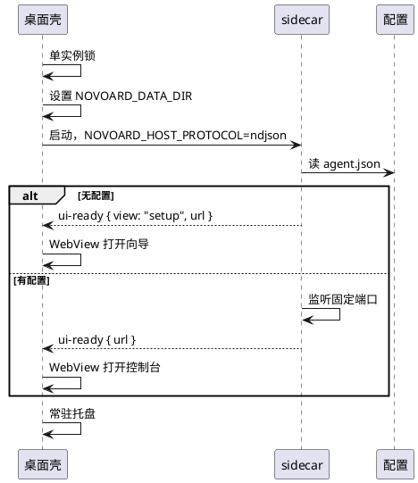

# PRD-6 分发与桌面壳

## 背景

本仓以"装上就能用"的形态分发到多个平台，不要求用户先装 Node。

## 方案

Node SEA（Single Executable Application）：把 sidecar 与 Node 运行时打成一个可执行文件。Windows/macOS 再套 Tauri 轻壳，负责启动 sidecar、开 WebView、托盘、单实例。Linux 直接分发 SEA，无壳。

## 用户故事

**US1 下载就能跑。** Windows、macOS（Intel 与 Apple Silicon）、Linux 各有产物。

**US2 首次启动有向导。** 引导填 Hub 地址与鉴权，测连通，写入配置。

**US3 壳只管壳。** 关窗不等于退出；托盘可重开窗口；第二次启动不新开实例。

**US4 更新不丢配置。** 升级保留数据目录与 `targets.yaml`。

**US5 崩了能看日志。** 日志位置固定，可打开。

## 产物矩阵

| 平台 | 架构 | 形态 |
| --- | --- | --- |
| macOS | arm64 | `.app` + `.dmg`（ad-hoc 签名，未 notarize） |
| macOS | x64 | `.app` + `.dmg` |
| Windows | x64 | NSIS 安装包（未做 Authenticode） |
| Linux | x64 | 无头 SEA zip |

Linux 没有 arm64 产物，当前无需求。

## 关键决策

**SEA 而不是 pkg 或 bun compile。** SEA 是 Node 官方能力，不引入额外工具链；与现有构建脚本兼容。构建脚本 `scripts/build-agent.mjs` 经 esbuild 打成 CJS 后注入官方 Node 二进制。

**Tauri 而不是 Electron。** Electron 会带整个 Chromium，体积翻几倍。Tauri 用系统 WebView。代价是各平台 WebView 行为有差异，需要冒烟。

**关窗不退出。** 磁贴与对等触发需要 sidecar 常驻。关窗只是收起界面，托盘还在。退出要显式选择。

**固定端口而不是动态。** `edition.json` 里 release 41783、dev 52641。壳直接拼地址，SSH 转发命令与书签也可预期。代价是端口被占用时启动失败。详见 [ADR-0002](../adr/0002-single-process-carrier.md)。

## 启动流程

壳不解析端口，因为端口是固定的。它读 `ui-ready` 事件里的 `url` 直接用。

## 宿主协议

`host-protocol.mjs` 定义，仅在 `NOVOARD_HOST_PROTOCOL=ndjson` 时启用：

- stdout 一行一个 JSON 事件：`v / type / ts` 加上类型相关字段。
- 事件类型：`ui-ready`、`stopping`、`stopped`、`fatal`、`protocol-error`。
- stdin 一行一个 JSON 命令，当前只有 `shutdown`。
- stdin 关闭视为宿主消失，sidecar 主动停机。

宿主模式下普通日志只写文件，不碰 stdout，也不镜像 stderr。这是为了避免日志污染协议流。

## 首次启动向导

`setup-wizard.mjs` 提供，占用固定端口。三个字段：Hub 地址、agentId（可选）、agentToken。

流程：填表 → `POST /api/setup/test` 验证连通 → `persistAgentConfig` 写入 `agent.json`（权限 0600）→ 向导退出 → 控制台接着听同一端口。

`PUT /api/settings` 返回 `restartRequired: true`，因为隧道客户端在启动时初始化，改配置必须重建。

## 停机

壳退出时先发 `shutdown` 命令，sidecar 走 `agent-runtime.shutdown`，超时 4 秒。超时后壳做进程级强杀兜底。这个双保险是必要的：脚本可能忽略 SIGTERM。

`local-a2a.close` 显式 `closeAllConnections()`，避免 SSE 长连接拖住停机。

## Linux 无头

无壳，直接跑 SEA。无 `agent.json` 时向导占用固定端口，保存后控制台接同一端口。

推荐 SSH 端口转发访问回环地址。需要从其他机器直连时，把 `uiHost` 配成非回环并设 `uiToken`（至少 16 字符），否则拒绝启动。这是明文 HTTP，公网使用必须自带 TLS 反代。

## 边界

- 不做自动更新，分发靠重新下载安装。
- 不做代码签名之外的额外加固。签名与公证在 CI 里完成。
- 不支持 Linux arm64。
- 首版是内测分发：Windows 未签名会有 SmartScreen 提示，macOS ad-hoc 签名首次运行可能需在系统设置里确认。

## 依赖

- 载体决策：[ADR-0002](../adr/0002-single-process-carrier.md)
- 信任边界：[ADR-0003](../adr/0003-loopback-trust-boundary.md)
